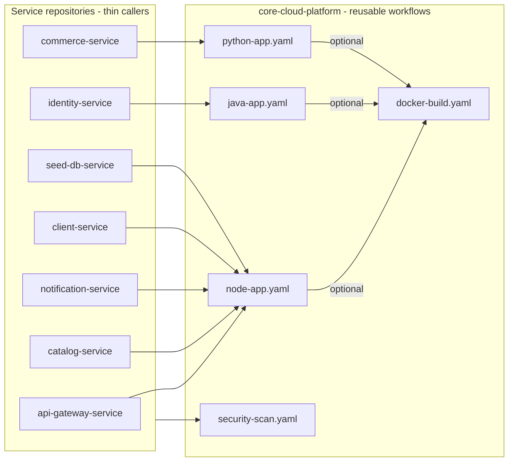

# Core Cloud Platform

Organization repository for **reusable GitHub Actions workflows**, shared delivery standards and
the project's **learning guides** (`docs/`).

> **In plain words:** every service repo has a tiny CI file that says *"run the shared Node (or Java,
> or Python) pipeline from core-cloud-platform"*. The real pipeline logic lives here, once. Fix or
> improve it here and every service gets the improvement.

## Platform Model



## Reusable Workflows

All workflows: trigger `workflow_call`, `permissions: contents: read`, every action pinned to a
**commit SHA**, scanners downloaded from official releases and **checksum-verified**.

| Workflow | What it does | Main inputs |
|---|---|---|
| `node-app.yaml` | `npm ci` → `npm test` (repo's coverage gate) → `npm run build --if-present` → optional Docker job | `node-version` (22), `run-tests`, `working-directory`, `build-docker`, `image-name`, `fail-on-vulnerabilities` |
| `java-app.yaml` | One `mvn verify` (compile + tests + JaCoCo gate + package) → optional Docker job | `java-version` (21), `run-tests`, `working-directory`, `build-docker`, `image-name`, `fail-on-vulnerabilities` |
| `python-app.yaml` | `pip install -r requirements-dev.txt` → `python -m pytest` → optional Docker job | `python-version` (3.12), `run-tests`, `working-directory`, `build-docker`, `image-name`, `fail-on-vulnerabilities` |
| `docker-build.yaml` | Build image (Buildx + layer cache) → **Trivy** scan, fails on fixable HIGH/CRITICAL → report artifact | `image-name`, `docker-context`, `dockerfile`, `application-artifact`, `fail-on-vulnerabilities` |
| `security-scan.yaml` | **gitleaks** scan of the full git history for leaked secrets | `gitleaks-version` |
| `ci.yaml` | CI for *this* repo: `actionlint` on every workflow + secret scan | — |

### How a service uses them

```yaml
# .github/workflows/ci.yaml in a service repository
name: Catalog Service CI
on:
  push:
    branches: [main]
  pull_request:

jobs:
  build:
    uses: ppmcad16a-cloud-platform/core-cloud-platform/.github/workflows/node-app.yaml@v1
    with:
      node-version: "22"
      build-docker: true
      image-name: catalog-service

  secrets:
    uses: ppmcad16a-cloud-platform/core-cloud-platform/.github/workflows/security-scan.yaml@v1
```

### Versioning (`@v1`)

Callers reference **`@v1`**, not `@main`. `v1` is a git tag that we move forward only after a
change has been tested. A breaking change gets a new major tag (`v2`), so services upgrade when
they are ready instead of breaking unexpectedly.

## Roadmap (multi-cloud project phases)

| Capability | State |
|---|---|
| Node / Java / Python build + test | Done |
| Image build + Trivy gate | Done |
| Secret scanning (gitleaks) | Done |
| Push images to ECR + ACR + Artifact Registry (OIDC, no stored keys) | Phase 8 |
| `terraform.yaml` — fmt/validate/lint → plan on PR → approved apply | Phase 3 |
| Trigger Jenkins deployment (one cloud at a time, smoke tests, auto-rollback) | Phase 8 |

## Workflow Governance

- Pin third-party actions to full commit SHAs (comment the version next to it).
- Set explicit `permissions` and use least privilege.
- Prefer GitHub OIDC over long-lived cloud access keys.
- Promote immutable image digests, not mutable tags.
- Keep secrets out of source code, images, Terraform variables, and logs.
- Store Terraform state remotely with encryption and locking.
- Require security and health gates before deployment.
- Keep callers thin and common delivery logic centralized here.

## Learning guides

Start at [`docs/00-prerequisites.md`](docs/00-prerequisites.md).
