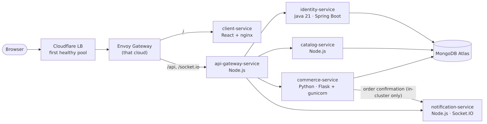
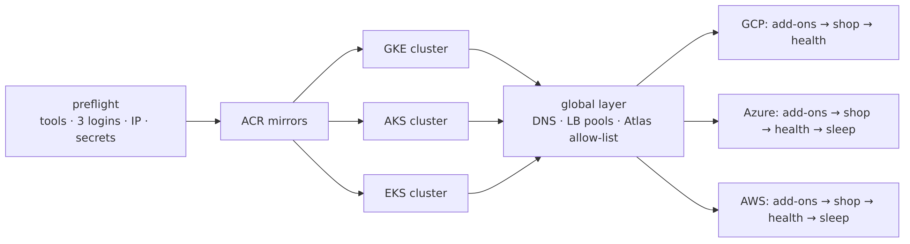

# 02 — Architecture

## 1. A request, end to end

1. The browser resolves `rishavmukhopadhyay.store`. Cloudflare answers with its own edge address (the record is *proxied*), terminates TLS and forwards the request to the **first healthy pool** — GCP, then Azure, then AWS (`steering_policy = "off"` = failover order).
2. The request reaches that cloud's **Envoy Gateway** (Gateway API). Its load balancer accepts **only Cloudflare's IP ranges** plus the admin IP, so nobody can bypass Cloudflare.
3. Envoy routes `/` to `client-service` (React served by nginx) and `/api` + `/socket.io` to `api-gateway-service`.
4. The API gateway forwards to `identity`, `catalog`, `commerce` and `notification` over Kubernetes DNS. Services talk only inside their own cluster — there is **no VPN or network link between clouds**.
5. Services that store data connect to **MongoDB Atlas** through the cloud's NAT with a **fixed outgoing IP**; Atlas only accepts those IPs, and each cloud uses its own database user.

## 2. The three clouds

| | GCP (primary) | Azure (standby) | AWS (standby) |
|---|---|---|---|
| Region | `asia-south1` (Mumbai), zone `-a` | `centralindia` (Pune) | `ap-south-1` (Mumbai), 2 AZs |
| Cluster | GKE Standard `prod-gke`, Kubernetes 1.36 | AKS `prod-aks` (Free tier, Azure CNI Overlay, Entra RBAC), 1.36 | EKS `prod-eks` (Pod Identity, EBS CSI, LB Controller), 1.37 |
| Nodes | 2 × `e2-standard-2` (autoscale 2–3) | 2 × `Standard_D2as_v5` | 2 × `t3.large` (0 while asleep, max 3) |
| Network | VPC `prod`, nodes `10.30.0.0/20`, pods `10.30.128.0/17` | VNet `10.20.0.0/16` | VPC `10.10.0.0/16`, private node subnets |
| Outgoing IP | Cloud NAT with `prod-egress` (**permanent**, 34.93.192.167) | NAT Gateway + static public IP | NAT Gateway + Elastic IP |
| Entrance | static IP `prod-ingress` → Envoy LB | static IP `pip-prod-ingress` → Envoy LB | NLB (LB Controller) → Envoy |
| Registry | Artifact Registry `mern` | ACR `acrmern0botwx` (+ mirrors of ESO/OpenCost images) | ECR, one repo per service |
| Vault | Secret Manager | Key Vault `kv-mern-0botwx` | SSM Parameter Store `/mern/*` |
| Backups | GCS `…-mongo-backups` | Blob `stbackup0botwx/mongo-backups` | S3 `ppmcad16a-mongo-backups-…` |
| Extra role | Jenkins (CD), central Grafana | — | — |

All three use the same machine shape (2 vCPU, 8 GB) so the same Helm values fit everywhere. Azure's free-trial limit of 4 vCPU per region is respected.

## 3. Terraform layout — what lives how long

Every cloud repo has the same four layers. Each layer is a separate Terraform stack with its own remote state (GCS / Azure Storage / S3, versioned).

| Layer | Contents | Lifetime |
|---|---|---|
| `bootstrap/` | state bucket, GitHub OIDC trust + plan/apply identities, monthly budget | created once, by hand |
| `environments/prod/foundation/` | registry, vault, backup bucket, CI push identities, DR identities, failover identity, GKE egress IP | **permanent** — survives between sessions |
| `environments/prod/cluster/` | network, NAT, Kubernetes cluster, node pool, ingress IP | **per session** — created by `up.yml`, destroyed by `down.yml` |
| `environments/prod/addons/` | Envoy Gateway, External Secrets, monitoring stack, Jenkins (GCP), LB Controller (AWS), platform config chart | **per session** |
| `global-platform` (own repo) | Cloudflare DNS / LB / pools / monitors / Access / Worker / notifications, Atlas users + allow-list, app secrets written into all 3 vaults | **per session** (re-created by `up.yml`) |

Stacks read each other's outputs through `terraform_remote_state` (for example, AKS and EKS read GKE's egress IP from GCP's *foundation* state so they can let Jenkins reach their APIs, and `global-platform` reads every cluster's ingress and egress IPs).

Because the GKE egress IP lives in the permanent foundation layer, the **three clusters no longer depend on each other and are created in parallel**:

## 4. Inside each cluster

One reusable Helm chart (`platform-deployments/charts/microservice`) deploys every service with:

| Feature | Setting | Why |
|---|---|---|
| Rolling update | `maxUnavailable: 0`, `maxSurge: 1` | a new pod must be Ready before an old one stops — zero downtime |
| Probes | startup + liveness (`/health`) + readiness (`/ready`, checks MongoDB) | traffic only reaches pods that can really serve |
| Graceful stop | `preStop` drain + 30 s grace period | in-flight requests finish during a rollout |
| Autoscaling | HPA 2–4 replicas at 70 % CPU (notification: 1 replica — Socket.IO keeps chat state in memory) | absorbs load spikes |
| Disruption budget | PDB `minAvailable: 1` | node maintenance never removes the last copy |
| Hardening | non-root, read-only root filesystem, no privilege escalation | smaller blast radius |
| Network policy | ingress allowed only from the gateway / the services that need it | a compromised pod cannot reach everything |
| Secrets | `ExternalSecret` from the cloud vault (`cloud-vault` ClusterSecretStore) | no secret in git or in Helm values |
| Routing | `HTTPRoute` for `/`, `/api`, `/socket.io` on the shared Envoy Gateway | one public entrance per cloud |
| Metrics | `ServiceMonitor` | Prometheus scrapes `/metrics` |

Per-service settings are in `values/services/<service>.yaml`; per-cloud differences (registry, hostnames, cloud label) in `values/clouds/<cloud>.yaml`.

## 5. The stopped-standby model

| State | GCP | Azure | AWS |
|---|---|---|---|
| Normal | serving everyone | `az aks stop` — control plane and VMs off | node group `0` nodes (control plane stays) |
| GCP outage | down | woken: `az aks start` | woken: node group `0 → 2` |
| Waking time (measured) | — | ≈ 6 min | ≈ 3 min |

Waking is done by (a) **automatically**: a Cloudflare notification "pool `mern-gcp` unhealthy" → Worker `mern-failover` → GitHub Actions `failover-wake.yml`, which logs in keylessly with identities that may *only* start AKS / resize the node group; or (b) **by hand**: `ansible-playbook playbooks/wake.yml -e cloud=azure`. A woken standby first catches up to the primary's image versions (`sync-shop`), because Jenkins skips sleeping clouds.

## 6. Observability topology

* Every cluster runs Prometheus + Alertmanager, Loki + Alloy and OpenCost, all installed from the **same tagged module** (`observability-platform//modules/mern-observability?ref=v1.1.0`), so rules and alerts are identical everywhere.
* The **central Grafana** in GKE queries GCP locally and Azure/AWS through `obs-azure.` / `obs-aws.` hostnames — read-only (`GET`) and protected by a Cloudflare Access service token.
* Each cloud's Alertmanager sends to Slack on its own, so alerts still arrive when GCP (and the central Grafana) is down.

## 7. Repositories

| Repository | Purpose |
|---|---|
| `api-gateway-service`, `identity-service`, `catalog-service`, `commerce-service`, `notification-service`, `client-service`, `seed-db-service` | application code, tests (coverage gates), Dockerfile, a 30-line `main.yaml` that calls the shared CI |
| `core-cloud-platform` | reusable GitHub workflows (node/java/python, docker-build, trigger-deploy, security-scan) + learning guides |
| `gcp-platform`, `azure-platform`, `aws-platform` | Terraform per cloud (bootstrap, foundation, cluster, addons) and its modules |
| `global-platform` | Cloudflare, Atlas, shared secrets, failover Worker |
| `platform-deployments` | Helm chart, values, Jenkinsfiles (deploy, backup, restore-drill), DR scripts, local Docker Compose |
| `observability-platform` | versioned Terraform module: alert rules, recording rules, dashboards |
| `platform-automation` | Ansible playbooks + the `failover-wake` workflow |
| `.github` | organisation profile page |

Every repository protects `main`: changes arrive through pull requests with required checks.
