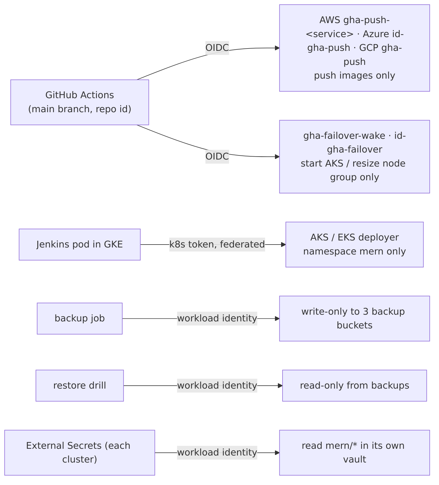
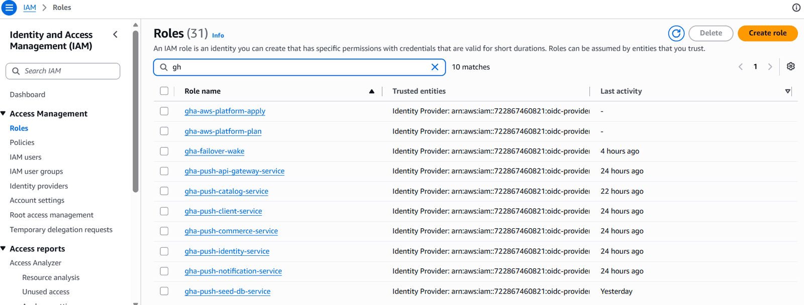
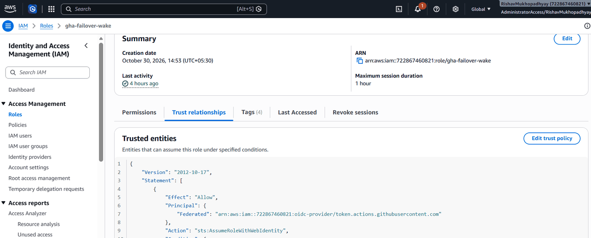
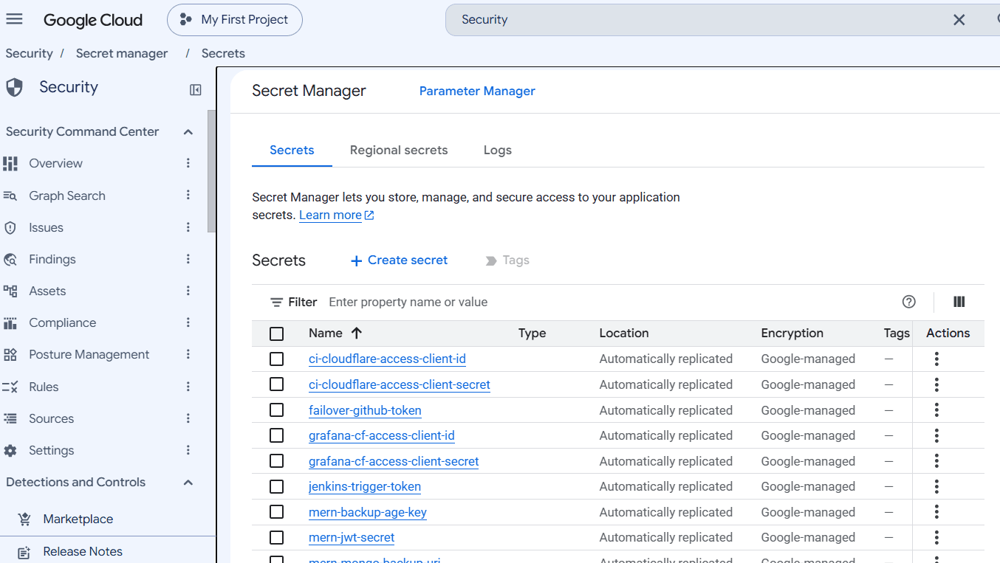
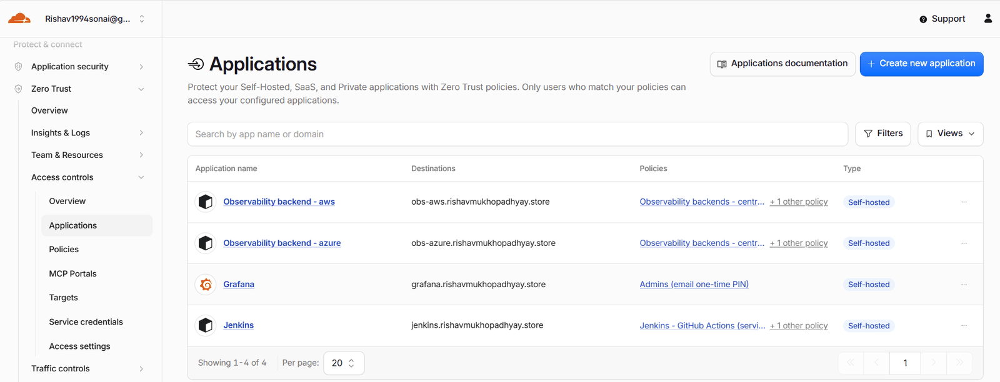
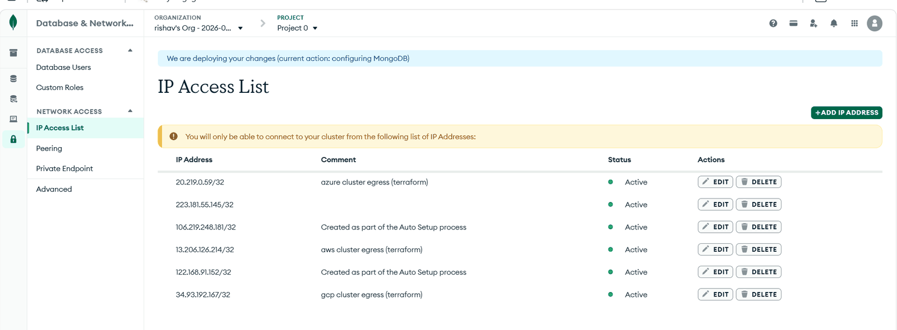

# 03 — Security

The platform follows three rules: **no stored credentials**, **every identity can do exactly one job**, and **every network door is closed unless it must be open**.

## 1. Identities — no keys anywhere

| Who | How it proves who it is | What it may do — and nothing else |
|---|---|---|
| GitHub Actions in a service repo | GitHub OIDC token, trusted only for the **main branch of that repo**, matched by the repo's permanent numeric id | push images: AWS `gha-push-<service>` (its *own* ECR repo only), Azure `id-gha-push` (AcrPush), GCP `gha-push` (Artifact Registry writer + read 3 CI secrets) |
| GitHub Actions `failover-wake` | OIDC, `platform-automation` main branch | Azure `id-gha-failover`: custom role *read + start* the AKS cluster; AWS `gha-failover-wake`: *describe + resize* the node group |
| Jenkins (pod in GKE) | its Kubernetes service-account token, federated to Azure and AWS | deploy into namespace `mern` of AKS/EKS only; read AKS power state / EKS node group size (to skip sleeping standbys) |
| Backup job | workload identity | **write-only** to the three backup buckets (no read, no delete — even in Azure, via a custom role) |
| Restore drill | workload identity | **read-only** from the backup buckets; Atlas user `restore-drill` may only touch the scratch database `mern_restore_drill` |
| External Secrets (each cluster) | workload identity / Pod Identity | read `mern/*` secrets in **its own cloud's** vault only |
| Cluster nodes | node identity | pull from that cloud's registry only |
| You (admin) | SSO / `az login` / `gcloud auth login` | everything — used only from the laptop, never stored in CI |

**Immutable OIDC subject.** The trust rules use GitHub's immutable subject format `repo:ppmcad16a-cloud-platform@308835253/<repo>@<repo-id>:ref:refs/heads/main`. A repository that is deleted and re-created under the same name gets a new id and does **not** inherit cloud access.

## 2. Secrets

| Secret | Created by | Stored in | Read by |
|---|---|---|---|
| `mern-mongo-uri` (one DB user per cloud) | `global-platform` (Atlas provider) | each cloud's own vault | that cloud's services via External Secrets |
| `mern-jwt-secret` (identical in all clouds, ≥ 32 chars) | `global-platform` (`random_password`) | all three vaults | identity, gateway, notification — a login made in one cloud stays valid after failover |
| `mern-origin-tls-crt/-key` | Cloudflare Origin CA via Terraform | all three vaults | Envoy Gateway (TLS between Cloudflare and the cluster) |
| `mern-seed-admin-password` | `global-platform` | all three vaults | seed job only |
| `mern-slack-webhook-url` | by hand, once, in GCP Secret Manager; `global-platform` copies it | all three vaults + Cloudflare notification webhook | Alertmanager (each cloud), Jenkins, Cloudflare |
| CI tokens (Cloudflare Access service token, Jenkins trigger token) | `global-platform` | GCP Secret Manager | GitHub Actions (`gha-push` may read exactly these) |
| `failover-github-token` | by hand (fine-grained PAT, `actions:write` on one repo) | GCP Secret Manager → Worker secret binding | Cloudflare Worker |
| `mern-backup-age-key` (private key) | by hand, once | GCP Secret Manager, copied to Key Vault and SSM **outside** `/mern/` | restore drill only — no cluster can read it |

Rules: no secret value is ever committed; `terraform.tfvars` files are git-ignored and contain only IP addresses and e-mails; global provider tokens (Cloudflare, Atlas) are typed into the session with hidden input and kept only in memory; Jenkins scripts use `set +x` before any command that handles a token.

## 3. Network doors

| Door | Who may come in |
|---|---|
| Cloudflare edge | the internet (HTTPS only, TLS 1.2+, *Always use HTTPS*) |
| Each cloud's entrance (Envoy LB) | **Cloudflare IP ranges** (read live from cloudflare.com) + the admin IP |
| Kubernetes API of each cluster | the admin IP + GKE's fixed egress IP (so Jenkins can deploy) |
| Pods | only the callers listed in their NetworkPolicy (gateway, specific services, Prometheus) |
| MongoDB Atlas | the three clusters' fixed egress IPs (managed by Terraform) |
| Jenkins, Grafana, `obs-*` | Cloudflare **Access**: admins by e-mail one-time PIN; GitHub Actions and Grafana by service token |
| TLS mode | **Full (strict)**: Cloudflare verifies the origin's certificate |

> **Finding from the final test:** the Atlas IP access list also contained a manually added `0.0.0.0/0` entry from early local development, which would have allowed connections from anywhere. It was removed on 31 Oct 2026; the list now holds only the Terraform-managed cluster IPs (plus three legacy personal IPs scheduled for removal). See [Troubleshooting](10-troubleshooting.md).

## 4. Supply chain

| Control | Where |
|---|---|
| Every third-party GitHub Action pinned to a **full commit SHA** | `core-cloud-platform/.github/workflows/*` |
| New tool / provider / chart versions adopted only when **≥ 14 days old** | team rule; Terraform lock files committed (incl. `linux_amd64` hashes) |
| Trivy downloaded from the official release and **checksum-verified**, then blocks fixable HIGH/CRITICAL vulnerabilities | `docker-build.yaml` |
| gitleaks scans the **whole git history** of every repo on every PR | `security-scan.yaml` |
| Images are tagged `main-<sha>` and **immutable** in all three registries | ECR / ACR / Artifact Registry settings |
| The **same digest** is pushed to all registries — what was scanned is what runs | `docker-build.yaml` |
| Workflows run with `permissions: contents: read` (+ `id-token: write` only where a cloud login is needed) | all workflows |

## 5. Least-privilege checks

| Check | How to see it |
|---|---|
| The backup identity can write a backup but cannot list or read one | tested with a throw-away pod (`AccessDenied` on list/read) |
| `gha-push-<service>` may push only to its own ECR repository | `aws-platform/environments/prod/foundation/ci-push.tf` — the policy's `Resource` is that one repository |
| The Jenkins deployer is limited to namespace `mern` | Kubernetes `Role`/`RoleBinding` in the `platform-config` chart (no `ClusterRole`) |
| The failover identity can start AKS but not stop, delete or change it | custom role "MERN failover - start AKS": `managedClusters/read` + `start/action` only |
| Jenkins/Grafana are not reachable without Cloudflare Access | an unauthenticated request receives the Access login page, not the application |
