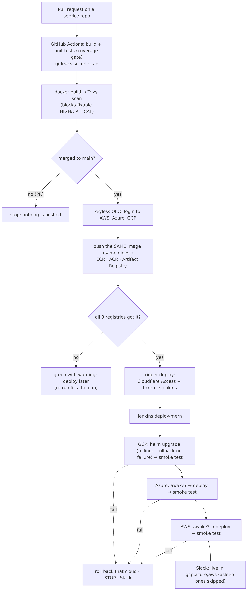
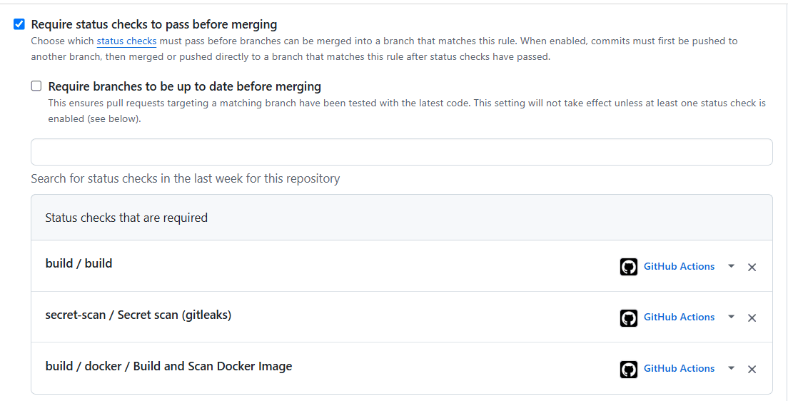
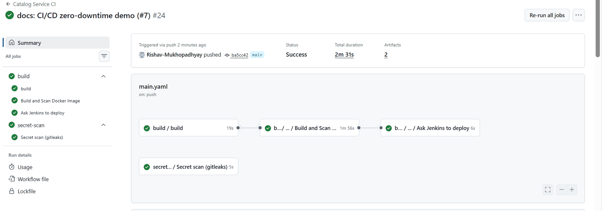
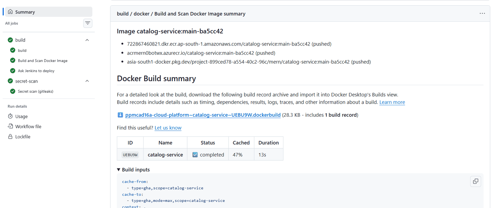
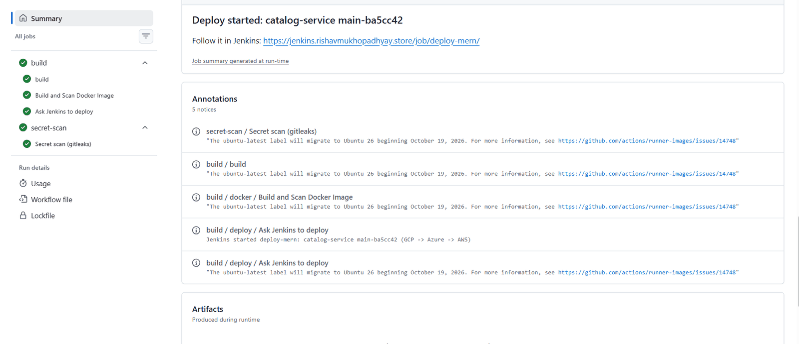
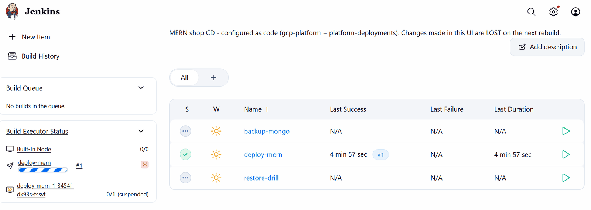
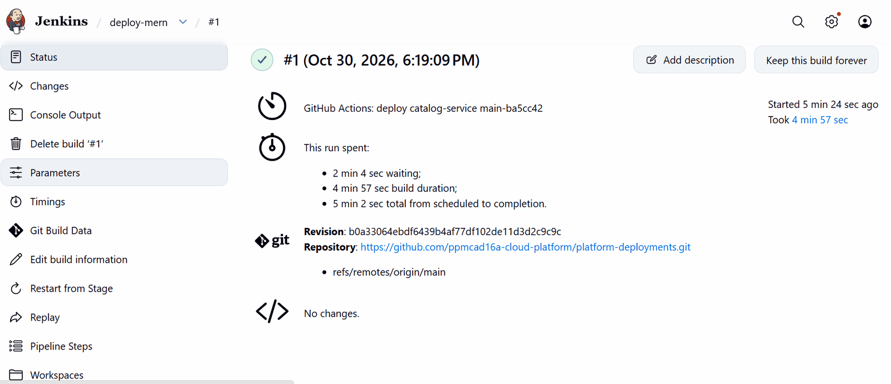
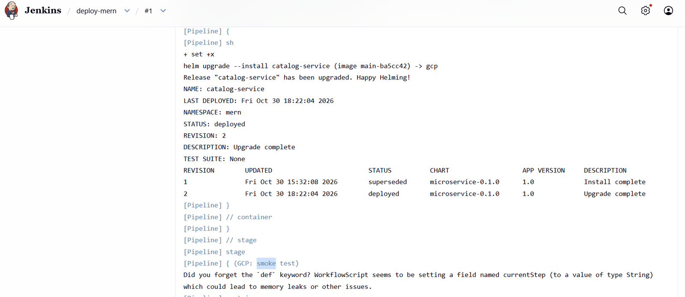
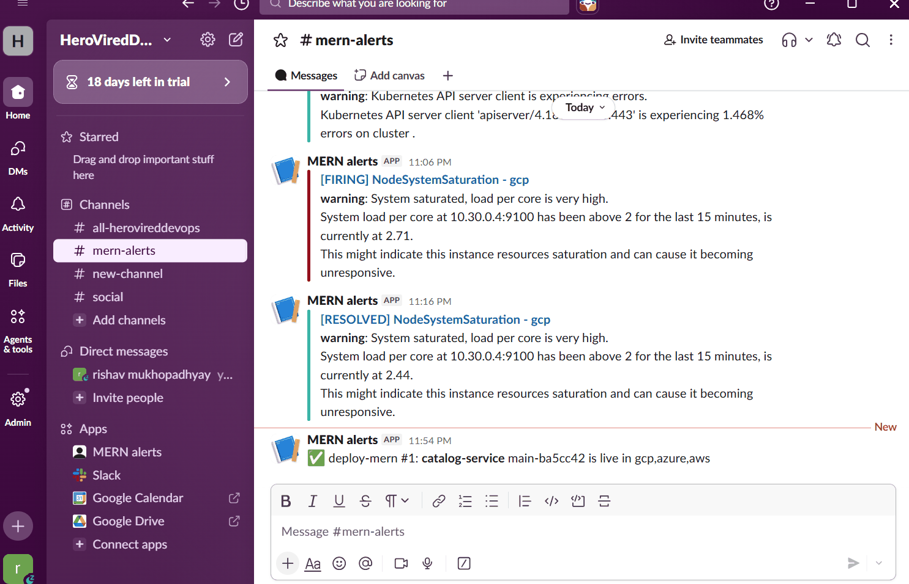

# 06 — CI/CD: from a pull request to three clouds

## 1. Continuous integration (GitHub Actions)

Each service repository contains only a small `main.yaml` that calls a shared, versioned workflow in `core-cloud-platform` (`node-app.yaml`, `java-app.yaml` or `python-app.yaml` `@v2`). The shared workflow does:

| Step | Pull request | Push to `main` |
|---|---|---|
| install + unit tests with coverage gate | ✅ | ✅ |
| gitleaks over the whole git history | ✅ | ✅ |
| `docker build` + Trivy (blocks fixable HIGH/CRITICAL) | ✅ | ✅ |
| keyless login to AWS, Azure, GCP | — | ✅ |
| push the **same image** (tag `main-<sha>`) to ECR, ACR, Artifact Registry | — | ✅ |
| ask Jenkins to deploy | — | ✅ (if all three registries have the image) |

**Registry outage tolerance (v2.2.0).** Each cloud's login and push stand on their own. If one registry is down, the image still goes to the others and the run ends green with a warning naming the missing cloud — but the automatic deploy waits, because Jenkins would fail on the cloud without the image. Re-running the workflow later skips registries that already have the tag, fills the gap and then deploys.

| Registries that got the image | Run | Automatic deploy |
|---|---|---|
| 3 | green | yes |
| 1–2 | green + warning | no — re-run later, or deploy now with `TARGETS=` |
| 0 | red | no |

**Versioning of the shared workflows:** `v1` (build + scan), `v2.0.0` (push to 3 registries), `v2.1.1` (deploy trigger), `v2.2.0` (registry-outage tolerance); `v2` always points to the newest compatible 2.x. Release order: merge → pull → check `git log -1` → tag → move `v2`.

## 2. The hand-off to Jenkins

`trigger-deploy.yaml` reads two secrets from GCP Secret Manager (with the keyless CI identity), then calls `https://jenkins.<domain>/generic-webhook-trigger/invoke` with `{"service": …, "image_tag": …}`. The request must pass **two locks**: Cloudflare Access (service token) and the Jenkins trigger token. When the clusters are off, the job ends green with *"Jenkins is offline … deploy later with SERVICE=x IMAGE_TAG=y"*.

## 3. Continuous delivery (Jenkins in GKE)

Jenkins is installed by Terraform (Helm chart 5.9.68) with Configuration-as-Code and Job DSL, so it is rebuilt identically every session. Jobs: `deploy-mern`, `backup-mongo`, `restore-drill`.

`deploy-mern` parameters: `SERVICE`, `IMAGE_TAG`, `TARGETS` (default `gcp,azure,aws`). Stages:

| Stage | What happens |
|---|---|
| Validate | service name, tag format, target list |
| GCP: deploy → smoke test | `helm upgrade --install --rollback-on-failure --wait --timeout 8m`, then `https://gcp.<domain>/api/health` must answer 200 |
| Azure: awake? | reads AKS power state; if *Stopped* → "sleeping standby, skipped" |
| Azure: credentials → deploy → smoke test | federated login (no stored key), same Helm command |
| AWS: awake? → credentials → deploy → smoke test | node group size 0 → skipped; else the same |
| Slack | `✅ deploy-mern #N: <service> <tag> is live in gcp,azure,aws (asleep, skipped: …)` or a failure message |

Clouds are deployed **one after another**. A failure rolls back that cloud (Helm restores the previous revision) and **stops** — later clouds keep the old version, earlier ones already run the new one, so releases must be backward compatible.

## 4. Why a deploy causes no downtime

1. Kubernetes rolling update with `maxUnavailable: 0`: a new pod starts **next to** the old ones.
2. The new pod receives traffic only after its **readiness probe** (`/ready`, checks MongoDB) passes.
3. The old pod gets `SIGTERM`, the `preStop` hook gives Envoy time to stop routing to it, the service finishes in-flight requests and exits (graceful shutdown in every language).
4. PodDisruptionBudgets keep at least one copy during node maintenance; HPA keeps 2–4 replicas.
5. Only one cloud changes at a time, and Cloudflare keeps serving from the primary.

**Measured:** on 29 Oct 2026 a probe that requested all three clouds continuously during a CI-triggered deploy recorded **0 failed requests** (catalog-service PR #6, run "CD test 2 (zero-downtime probe)"). In the final test (30 Oct) the probe was stopped before the deploy started, so that run is **not** counted as evidence; the Grafana *Failed requests (5xx)* panel read 0.00 % in every cloud afterwards. The probe script and how to repeat the measurement are in [Test report §D](09-test-report.md#d-ci--cd-one-merge-three-clouds).

## 5. Failure and edge cases

| Case | Behaviour |
|---|---|
| tests, gitleaks or Trivy fail | nothing is pushed or deployed |
| a registry is down | push to the others, warning, no auto-deploy (§1) |
| Jenkins offline | green run with "deploy later" |
| smoke test fails in Azure | Azure rolled back, AWS untouched, Slack alert (proven with a tag that exists only in GCP: Azure failed after up to 8 min, `Rollback to 2`, AWS got no new revision) |
| standby asleep | skipped, caught up on wake |
| GCP (Jenkins) down | break-glass `ansible-playbook playbooks/deploy.yml -e service=… -e tag=…` |

## 6. Where the pieces live

| Piece | Repo / file | Purpose |
|---|---|---|
| Push identities | `aws/azure/gcp-platform/environments/prod/foundation/ci-push.tf` | keyless identities that may only **add** images |
| Language pipelines | `core-cloud-platform/.github/workflows/{node,java,python}-app.yaml` | build + test; inputs `push-images`, `deploy-after-push` |
| Image workflow | `core-cloud-platform/.github/workflows/docker-build.yaml` | build, scan, push to 3 registries (main only) |
| Deploy trigger | `core-cloud-platform/.github/workflows/trigger-deploy.yaml` | reads the Access and trigger tokens from GCP Secret Manager, calls Jenkins |
| Service opt-in | `<service>/.github/workflows/main.yaml` | `push-images: true`, `deploy-after-push: true` (seed-db: image only) |
| Jenkins door | `global-platform/jenkins-access.tf` | DNS (only while GKE runs), Access application + policies, service token, CI secrets |
| Jenkins itself | `gcp-platform/environments/prod/addons/jenkins.tf` + `values/jenkins.yaml` | Helm release, Configuration-as-Code, Job DSL, Generic Webhook Trigger |
| Pipelines | `platform-deployments/pipelines/*.Jenkinsfile` | deploy, backup, restore drill |

## 7. Manual operations

* **Open Jenkins:** `https://jenkins.<domain>` → Cloudflare e-mails a PIN → user `admin`, password `terraform output -raw jenkins_admin_password` in `gcp-platform/environments/prod/addons`.
* **Roll back:** run `deploy-mern` with the previous `IMAGE_TAG`.
* **Deploy to one cloud only:** set `TARGETS` (e.g. `gcp`).
* **Failure test:** an `IMAGE_TAG` that exists only in Artifact Registry deploys to GCP, fails in Azure after up to 8 minutes (Helm `--timeout 8m`), rolls Azure back and skips AWS; old pods serve throughout.

Verified on 29 Oct 2026: 7 services built, scanned and pushed with an identical digest in ECR, ACR and Artifact Registry; the offline path ended green with "deploy later"; a merge (catalog-service PR #5 → `main-c33cefa`) started Jenkins and reached all clouds; the failure path rolled Azure back (`Rollback to 2`) and gave AWS no new revision.
