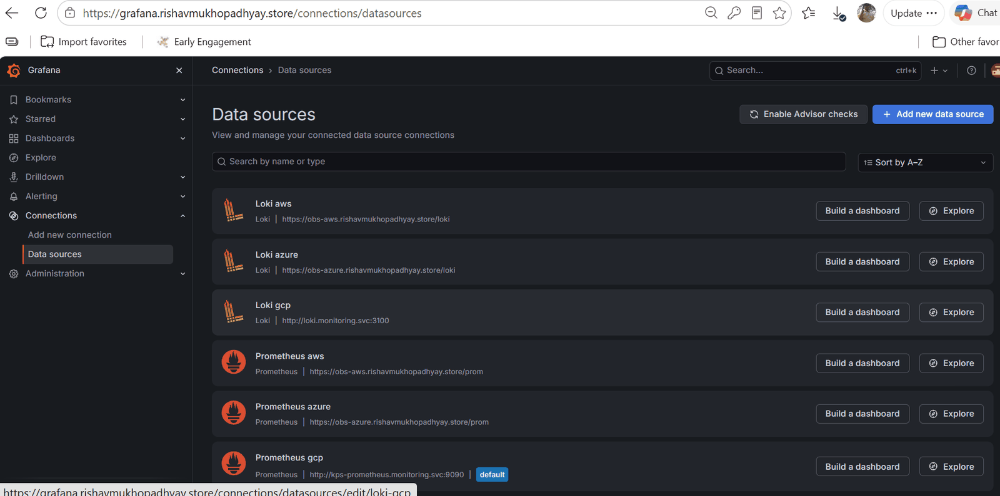
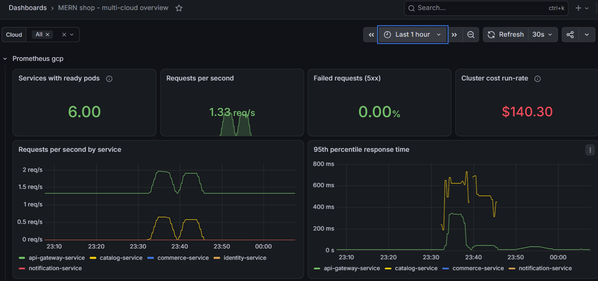
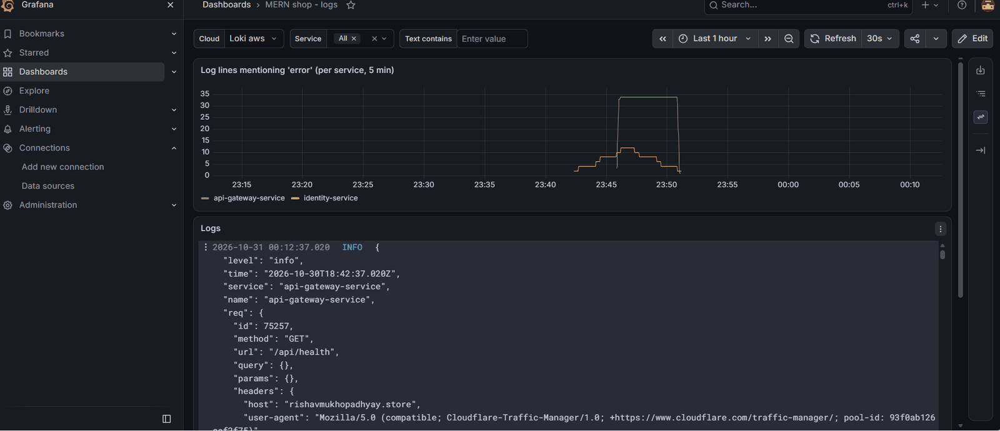
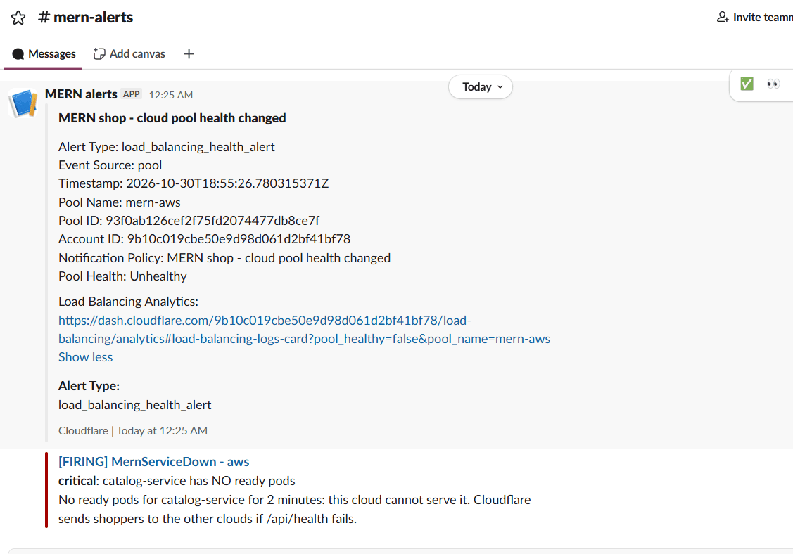
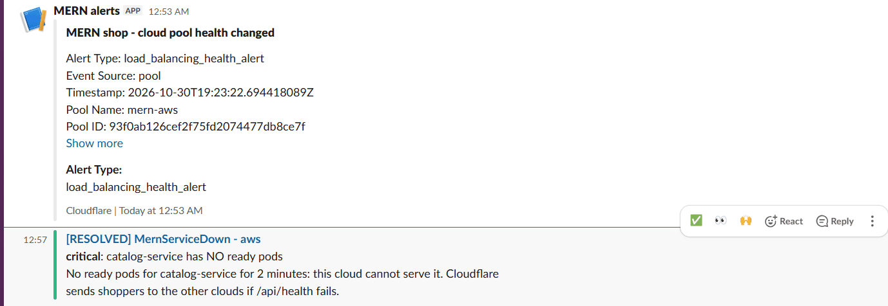
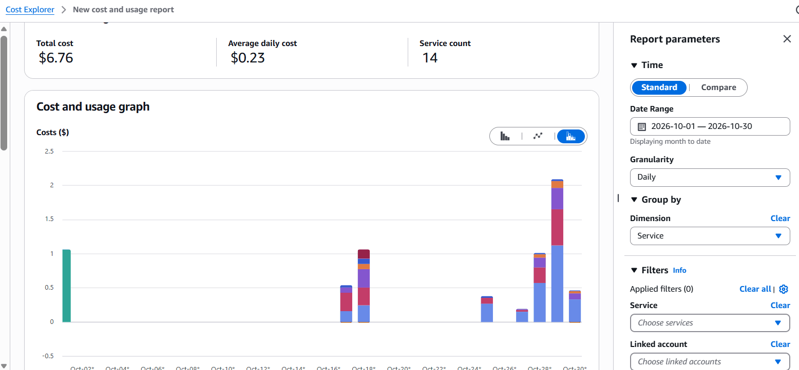
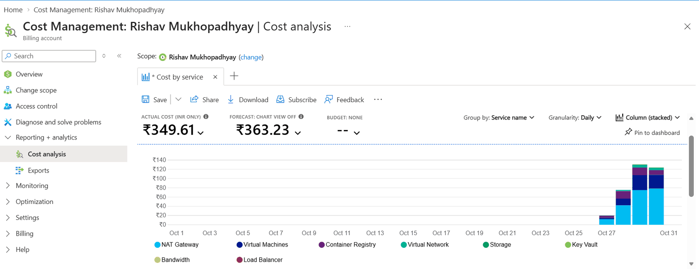
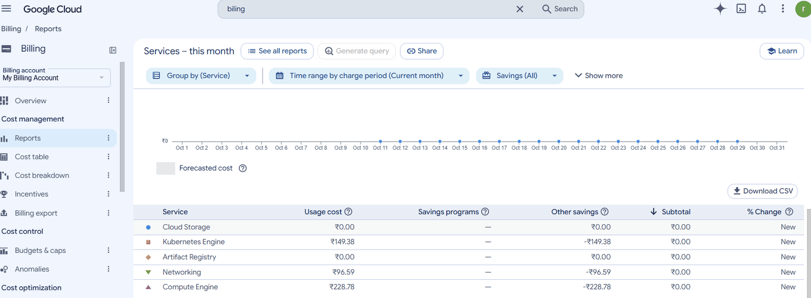
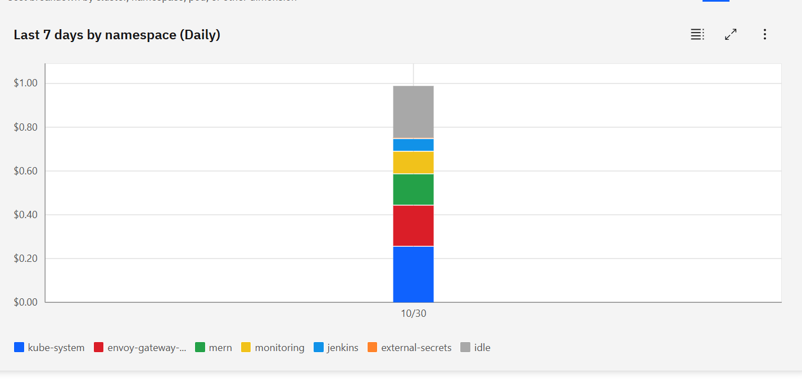
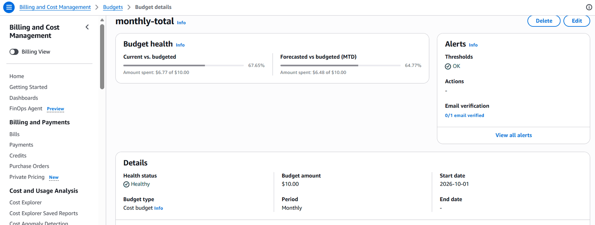

# 07 — Monitoring, alerts and cost

## 1. What runs where

| Component | In every cluster | Central (GKE only) |
|---|---|---|
| Prometheus + Alertmanager (kube-prometheus-stack 92.6.0) | ✅ scrapes nodes, pods and every service's `/metrics` | — |
| Loki 7.3.0 + Alloy 1.13.1 | ✅ collects every container's JSON logs, adds `cloud`, `app`, `pod` labels | — |
| OpenCost 2.5.32 | ✅ cost per node / namespace from list prices | — |
| Alert rules + dashboards | ✅ from module `observability-platform` **v1.1.0** (identical in every cloud) | — |
| Grafana | — | ✅ `https://grafana.<domain>` behind Cloudflare Access; data sources: 3 × Prometheus, 3 × Loki |

Azure and AWS expose their Prometheus/Loki to the central Grafana only through `obs-azure.` / `obs-aws.` hostnames — `GET` only, Cloudflare Access service token required.

## 2. Dashboards

**MERN shop — multi-cloud overview** (one row per cloud, `cloud` selector at the top):

| Panel | Meaning |
|---|---|
| Services with ready pods | how many of the 6 services can serve right now (healthy = 6) |
| Requests per second | traffic through the gateway |
| Failed requests (5xx) | share of server errors |
| Cluster cost run-rate | OpenCost: this cluster's nodes, per 30-day month at the current size |
| Requests per second by service · 95th percentile response time · 5xx per second · container restarts | per-service RED metrics (rate, errors, duration) |

**MERN shop — logs**: log lines mentioning "error" per service, and the raw JSON logs, filterable by cloud and service. In *Explore*, `{namespace="mern", app="catalog-service"}` shows one service's logs in one cloud.

## 3. Alerts → Slack (`#mern-alerts`)

| Alert | Fires when | Severity |
|---|---|---|
| **MernServiceDown** | a deployment in `mern` has **no ready pod for 2 min** — this cloud cannot serve it | critical |
| **MernHighErrorRate** | > 5 % of a service's requests fail with 5xx for 5 min (health-check traffic excluded since v1.1.0) | critical |
| **MernServiceDegraded** | fewer ready pods than wanted for 10 min (crash loop, image pull, no room) | warning |
| **MernSlowResponses** | p95 response time > 1 s for 10 min | warning |
| **MernPodRestarting** | a container restarted > 2 times in 15 min | warning |
| kube-prometheus-stack defaults | e.g. `NodeSystemSaturation`, API-server errors | warning/critical |
| **Cloudflare pool health** | a cloud's pool turns unhealthy / healthy | notification |
| **Jenkins** | deploy succeeded / failed / standby skipped; backup and restore results | info |

Each cloud's Alertmanager posts to Slack directly (webhook from its own vault), so alerts keep arriving when GCP — and the central Grafana — is down.

## 4. Cost

### 4.1 What was actually billed (1–30 October 2026)

| Cloud | Billed | Main items |
|---|---|---|
| AWS | **US $6.76** | EKS control plane, EC2 nodes, NAT gateway, load balancer |
| Azure | **₹349.61** (≈ US $4.2) | NAT gateway, VMs, container registry, load balancer, storage |
| GCP | **₹474.75** gross (Compute ₹228.78 · Kubernetes Engine ₹149.38 · Networking ₹96.59), **₹0 payable** (free credits) | |
| MongoDB Atlas | US $0 | M0 free tier |
| **Total** | **≈ US $17 for a month of building and testing three clouds** | plus the Cloudflare Load Balancing add-on (US $5/month) and the domain |

### 4.2 What it would cost to leave running

OpenCost run-rates measured with all three clusters awake (nodes only, list prices, per 30-day month):

| Cluster | Run-rate |
|---|---|
| GCP (2 × e2-standard-2 + Jenkins/Grafana load) | **US $140.30** |
| AWS (2 × t3.large) | **US $130.82** |
| Azure (2 × D2as_v5) | **US $81.17** |

| Operating model | Node cost / month | Comment |
|---|---|---|
| Active-active, 24/7 | ≈ US $352 | plus 3 × NAT, LB, EKS control plane (US $73) |
| **Primary + stopped standbys, 24/7** | ≈ US $140 | standby nodes cost **$0** while asleep → **−60 %** (≈ US $212 saved); the EKS control plane, NAT gateways, IPs and disks still cost money |
| **Sessions only (what we run)** | pay per hour of use | ≈ US $0.8–1 per working hour with all three clusters awake (nodes ≈ $0.48/h + NAT, load balancers, EKS control plane); nothing per-hour between sessions |

### 4.3 How cost is kept low

| Measure | Effect |
|---|---|
| Clusters, add-ons and the global layer exist **only during sessions** (`up.yml` / `down.yml`) | no node, NAT or load-balancer cost between sessions |
| **Stopped standbys** | Azure/AWS nodes off unless GCP fails |
| Small, equal node shapes (2 vCPU / 8 GB), autoscaling 2–3 | fits free-trial quotas |
| GKE **zonal** Standard cluster | no GKE management fee for one zonal cluster |
| AKS **Free** tier, Atlas **M0** | $0 control plane / database |
| Artifact Registry keeps only the newest 10 images; Azure backup storage has a lifecycle policy | storage stays small |
| `down.yml` **leftover check** | catches orphaned load balancers and disks — the classic silent cost |
| **Budgets** (AWS $10, Azure $10, GCP ₹850 ≈ $10) with e-mail alerts | warning long before credits run out |
| OpenCost per namespace | shows what each part of the platform costs |

