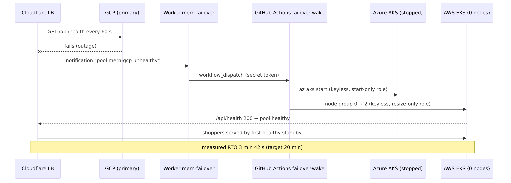
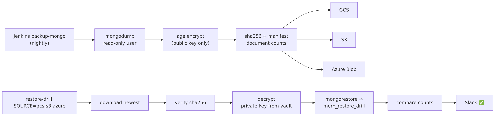
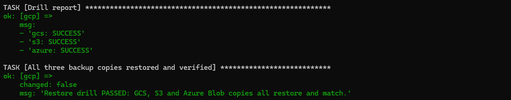
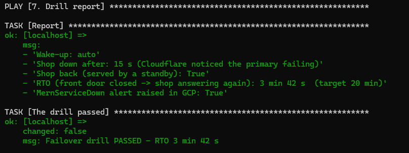

# 08 — Disaster recovery and failover

## 1. What can fail, and what happens

| Failure | Detection | Recovery | Time | Data loss |
|---|---|---|---|---|
| a pod crashes | probes | Kubernetes restarts / replaces it; other replicas keep serving | seconds | none |
| a node disappears | Kubernetes | pods rescheduled; PDB keeps one copy | 1–2 min | none |
| a bad release | smoke test per cloud | Helm rolls that cloud back, pipeline stops, Slack | ≤ 8 min | none |
| a **standby** cloud is lost | Cloudflare pool alert | nothing urgent — GCP serves everyone; rebuild with `up.yml` | — | none |
| the **primary (GCP)** is lost | Cloudflare monitor (60 s) | **automatic**: Cloudflare → Worker → GitHub Actions wakes Azure and AWS; the first healthy pool takes the traffic | **RTO 3 min 42 s** (measured) | none (shared database) |
| the database (Atlas) is lost | `/api/health` fails in every cloud, MernServiceDown | restore the newest encrypted backup into a new cluster (runbook §4.3) | ≈ 1 h (manual) | **RPO ≤ 24 h** — since the last nightly backup (between sessions no cluster runs, so nothing is written) |
| one backup copy is lost or corrupt | restore drill per source | use one of the other two copies | minutes | none |
| a registry is down | CI warning | other registries still get the image; re-run fills the gap | — | none |

## 2. Failover: the stopped-standby model



* Cloudflare's load balancer has three pools in failover order **gcp → azure → aws** and checks `GET /api/health` on each every 60 s. `/api/health` is a *deep* check: the API gateway asks every backend's `/ready`, which checks MongoDB — so "healthy" means "can really serve a shopper".
* Azure and AWS normally **sleep** (AKS stopped, EKS node group at 0). All their configuration — cluster, add-ons, shop, secrets, DNS, pool — stays in place, like a stopped EC2 instance.
* When the **gcp** pool turns unhealthy, a Cloudflare notification policy calls the Worker `mern-failover` (`https://mern-failover.<subdomain>.workers.dev`). The Worker checks a shared secret and starts the GitHub workflow `platform-automation/.github/workflows/failover-wake.yml` with a fine-grained token stored in GCP Secret Manager → Worker secret binding.
* The workflow logs in **keylessly** with identities that may only *start* AKS or *resize* the node group, wakes both standbys in parallel, and stops if there is nothing to wake.
* The first standby that answers `/api/health` with 200 takes the traffic (AWS woke in 2 min 48 s, Azure in ≈ 6 min in the drill).

**Principle:** the failover control plane (Cloudflare + GitHub Actions) does **not** live in the thing that fails (GCP).

### What survives a GCP outage

| Capability | During a GCP outage |
|---|---|
| Shop for customers | ✅ served by Azure/AWS after the automatic wake-up |
| Image builds (CI) | ✅ GitHub Actions; ECR/ACR still receive images (v2.2.0 tolerates Artifact Registry being down) |
| Deployments (CD) | ⚠️ Jenkins runs in GKE → use break-glass `ansible-playbook playbooks/deploy.yml` |
| Alerts | ✅ Azure/AWS Alertmanagers post to Slack directly; Cloudflare pool alerts |
| Central Grafana | ❌ lives in GKE → use each cloud's Prometheus/Loki directly until GCP is back |
| Nightly backup | ❌ job runs in Jenkins → take a manual backup if the outage is long |
| Secrets | ✅ each cloud has its own vault (copies written by `global-platform`) |

## 3. Backup and restore



| | Backup (`backup-mongo`, nightly while the platform runs, or on demand) | Restore drill (`restore-drill SOURCE=gcs\|s3\|azure`) |
|---|---|---|
| Database access | Atlas user `backup-ro` (read-only) | Atlas user `restore-drill` (only database `mern_restore_drill`) |
| Encryption | `age` with the **public** key only — the job can encrypt but never decrypt | private key read from the vault, deleted after the job |
| Integrity | SHA-256 + manifest with document count per collection | checksum must match; every collection's count must match |
| Storage | GCS, S3, Azure Blob — the job **fails unless all three** uploads succeed | newest copy from the chosen cloud |
| Identity | write-only per bucket (Azure: Put Blob over REST because the identity may not even read) | read-only per bucket |
| Result | Slack `💾 backup-mongo #N: <name> stored in GCS + S3 + Azure Blob` | Slack `✅ restore-drill #N: <name> from <source> restored and verified` |

The private key exists in GCP Secret Manager, Azure Key Vault and AWS SSM (outside `/mern/`, so no cluster can read it) and in a password manager — a backup can be restored even if GCP is gone completely.

Example manifest (final test): `mern_ecommerce`, 14,711 bytes, `products 100, orders 13, carts 13, brands 10, categories 10, contacts 8, users 5, reviews 2, merchants 1, wishlists 1`.

## 4. Runbooks

### 4.1 GCP is down (real outage)

1. Check Cloudflare → Load Balancing: `mern-gcp` critical; Slack shows "pool unhealthy".
2. Watch GitHub → `platform-automation` → Actions → **Failover – wake standbys**. If it did not start within 5 minutes, wake by hand: `ansible-playbook playbooks/wake.yml -e cloud=azure` (and `aws`).
3. Confirm `https://<domain>` answers and `azure.`/`aws.<domain>/api/health` is `ok`.
4. Releases during the outage: `ansible-playbook playbooks/deploy.yml -e service=… -e tag=…`.
5. When GCP is back and healthy, Cloudflare returns traffic to it automatically (failover order). Put the standbys back to sleep: `ansible-playbook playbooks/standby.yml`.

### 4.2 A whole cloud must be rebuilt

The cloud's foundation (registry, vault, backups) is permanent and in Terraform state; clusters are rebuilt every session anyway. Run `ansible-playbook playbooks/up.yml` — the guarded plan shows exactly what will be created.

### 4.3 The database is lost

1. Create a new Atlas cluster (or project) and update `atlas_project_id`, `atlas_cluster_name`, `mongo_host` in `global-platform/variables.tf`.
2. `terraform apply` in `global-platform` → new per-cloud users and connection strings in all three vaults; External Secrets refreshes them (restart the deployments to apply at once).
3. Restore the newest backup into the **real** database: run the restore steps by hand with a user that may write `mern_ecommerce` — download the newest archive (`scripts/dr/download-latest.sh <gcs|s3|azure>`), verify its SHA-256 against the manifest, decrypt with the private key from the vault (`age -d -i key.txt`), then `mongorestore --uri "<uri>" --gzip --archive=<file> --nsInclude 'mern_ecommerce.*'`.
4. Check the document counts against the manifest, then `/api/health` in every cloud.

### 4.4 Prove it regularly

```bash
ansible-playbook playbooks/drill-restore.yml      # all three backup copies restore and match
ansible-playbook playbooks/drill-failover.yml     # primary fails, standbys wake, RTO measured
```

## 5. Drill results (final test, 30 Oct 2026)

| Drill | Result |
|---|---|
| Backup `mern-20261030T212438Z` | stored in GCS + S3 + Azure Blob |
| Restore drill | **gcs: SUCCESS · s3: SUCCESS · azure: SUCCESS** — "Restore drill PASSED" |
| Failover drill (automatic wake-up) | shop down after 15 s → standbys woken by Cloudflare → Worker → GitHub Actions → shop back; **RTO 3 min 42 s** (target 20 min); MernServiceDown raised in GCP |



