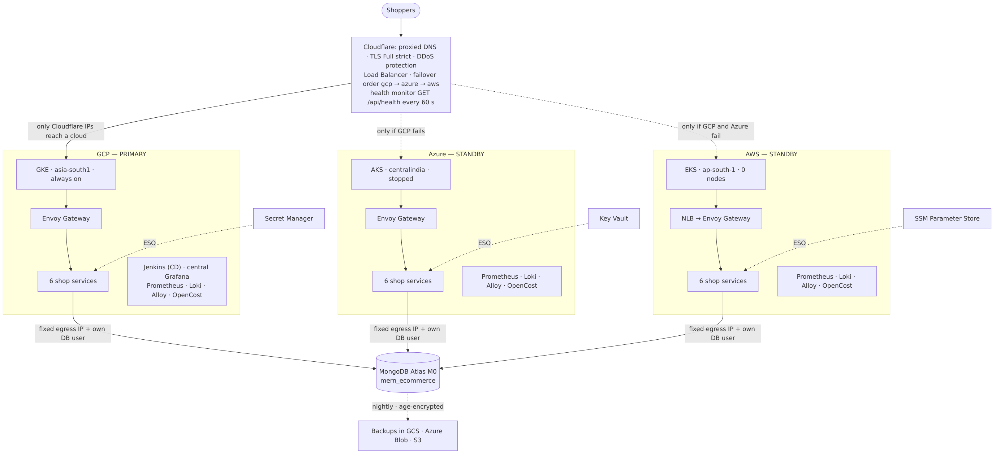

# Multi-Cloud MERN Platform — Project Handbook

**HeroVired DevOps Capstone · Problem Statement #5: Multi-Cloud Deployment and Management with Terraform**
GitHub organisation: [`ppmcad16a-cloud-platform`](https://github.com/ppmcad16a-cloud-platform) · Live domain (during sessions): `https://rishavmukhopadhyay.store`

A polyglot MERN e-commerce shop, split into six microservices, runs on **Google Cloud (GKE), Microsoft Azure (AKS) and Amazon Web Services (EKS)**. Everything is created by Terraform, delivered by GitHub Actions + Jenkins, protected by keyless identities, watched by Prometheus/Grafana/Loki, backed up to all three clouds, and switched on and off with one Ansible command each.

**Downloads:** [Project report (Word)](deliverables/Project-Report.docx) · [Presentation (PowerPoint, ~12 min)](deliverables/Presentation.pptx)

## Results at a glance (final test, 30–31 Oct 2026)

| What we proved | Result | Evidence |
|---|---|---|
| Whole platform from code in parallel (3 clusters + add-ons + shop) | `up.yml` green on all 3 clouds in **23 min 13 s** (warm GKE/AKS, cold EKS) | [Test report §B](09-test-report.md#b-session-start-upyml) |
| Same app in 3 clouds, one shared database | 6/6 services ready in every cloud, `/api/health` = ok ×3 | [§C](09-test-report.md#c-everything-running) |
| CI → CD with one merge | PR → scan → **same image in 3 registries** → Jenkins → live in gcp, azure, aws in **4 min 57 s** | [§D](09-test-report.md#d-ci--cd-one-merge-three-clouds) |
| Automatic cloud failover | GCP down → standbys woken **automatically** → shop back, **RTO 3 min 42 s** (target 20 min) | [§G](09-test-report.md#g3-failover-drill-gcp-goes-down) |
| Disaster recovery | Encrypted backup in GCS + S3 + Azure Blob; restore drill **passed from all 3** | [§G](09-test-report.md#g1-backup-to-three-clouds) |
| Monitoring & alerting | Central Grafana over 3 clouds; MernServiceDown + Cloudflare pool alerts in Slack, then RESOLVED | [§E](09-test-report.md#e-monitoring-alerts-and-cost) |
| Cost control | Real bill Oct 1–30: **AWS $6.76 · Azure ₹349.61 · GCP ₹474.75 (credits)** ≈ **US $17 for the month** | [Monitoring & cost](07-monitoring-and-cost.md) |

## Chapters

| # | Chapter | Read it when you want to… |
|---|---|---|
| 01 | [Project overview](01-project-overview.md) | understand the goal, the requirements and how each one is met |
| 02 | [Architecture](02-architecture.md) | see how the pieces fit: clouds, network, Kubernetes, standby model |
| 03 | [Security](03-security.md) | check identities, secrets, network restrictions and least privilege |
| 04 | [Setup guide — run it yourself](04-setup-guide.md) | run the shop on your laptop, or rebuild the whole platform in your own accounts |
| 05 | [Operations runbook](05-operations-runbook.md) | start/stop a session, deploy, roll back, wake a standby, break-glass |
| 06 | [CI/CD](06-ci-cd.md) | follow a code change from pull request to three clouds |
| 07 | [Monitoring & cost](07-monitoring-and-cost.md) | find dashboards, alerts, logs and the cost analysis |
| 08 | [Disaster recovery & failover](08-disaster-recovery-and-failover.md) | handle a cloud outage, a lost database or a restore |
| 09 | [Test report](09-test-report.md) | see the final end-to-end test with screenshots |
| 10 | [Troubleshooting](10-troubleshooting.md) | fix a problem we have already met (and how we found it) |
| 11 | [Limitations & improvements](11-limitations-and-improvements.md) | know the known limitations and possible improvements |

In-depth guides: [Prerequisites](guides/prerequisites.md) · [Repositories & shared CI](guides/repositories-and-ci.md) · [Cloud-ready services](guides/cloud-ready-services.md).

## Technology in one table

| Area | Technology |
|---|---|
| Application | React (client), Node.js (api-gateway, catalog, notification, seed-db), Java 21 Spring Boot (identity), Python Flask + gunicorn (commerce) |
| Database | MongoDB Atlas M0 (AWS Mumbai), database `mern_ecommerce`, one DB user per cloud |
| Infrastructure as code | Terraform 1.16.6 — per-cloud stacks (bootstrap / foundation / cluster / add-ons) + `global-platform` |
| Clouds | GKE `asia-south1-a` · AKS `centralindia` · EKS `ap-south-1` |
| Kubernetes add-ons | Envoy Gateway v1.9.2 (Gateway API), External Secrets 2.12.0, AWS LB Controller 3.6.0, kube-prometheus-stack 92.6.0, Loki 7.3.0, Alloy 1.13.1, OpenCost 2.5.32, Jenkins 5.9.68 |
| Global traffic | Cloudflare DNS, TLS Full (strict) with Origin CA certs, Load Balancer with `/api/health` monitors, Zero Trust Access, a Worker for automatic failover |
| Secrets | GCP Secret Manager · Azure Key Vault · AWS SSM Parameter Store, synced by External Secrets with workload identity |
| CI | GitHub Actions reusable workflows (`core-cloud-platform@v2`), gitleaks, Trivy, keyless OIDC |
| CD | Jenkins in GKE (Configuration-as-Code, Job DSL, Generic Webhook Trigger), Helm 4 |
| Automation | Ansible 2.21 in WSL Ubuntu: `toolchain`, `preflight`, `up`, `down`, `standby`, `wake`, `deploy`, drills |
| Observability | Prometheus + Alertmanager, Grafana (central), Loki + Alloy, OpenCost, Slack alerts |
| Disaster recovery | `mongodump` + `age` encryption → GCS, S3, Azure Blob; scripted restore drills |
